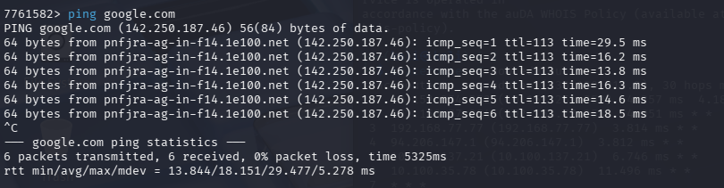
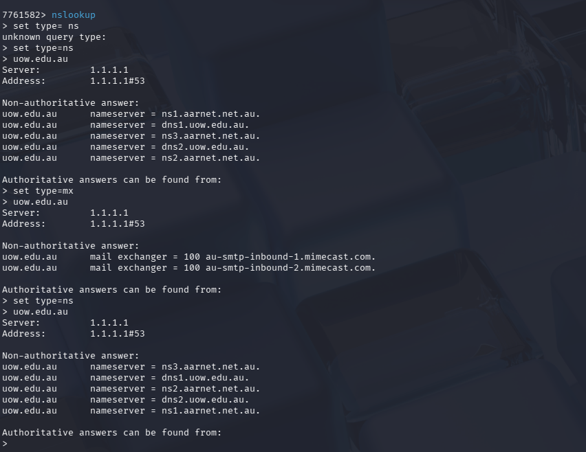
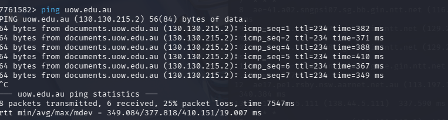
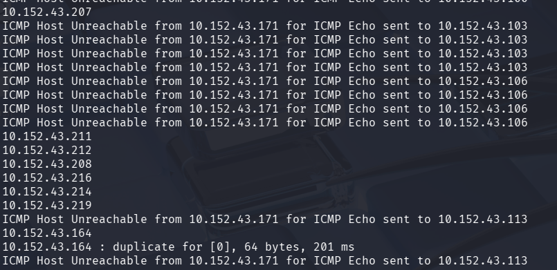
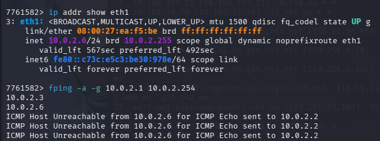
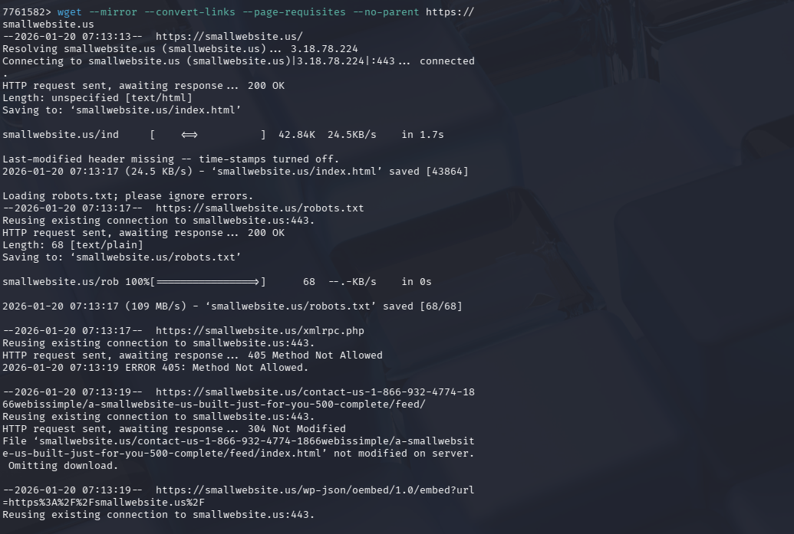
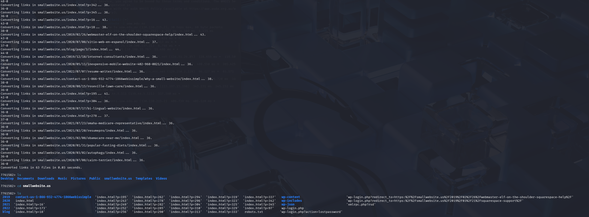
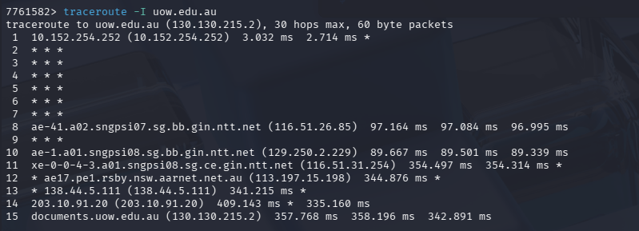
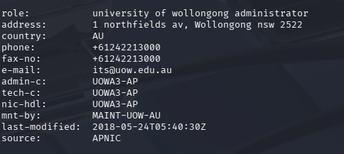
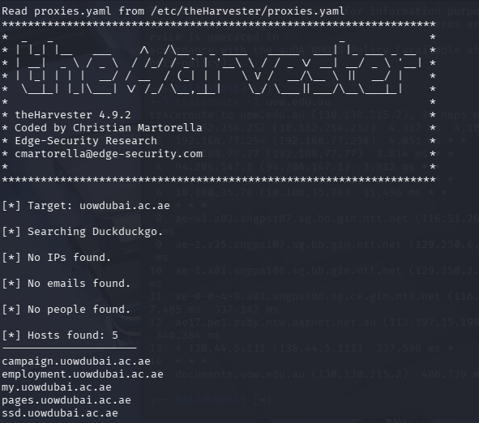

# Intelligence Gathering & Network Reconnaissance

**Domain:** Ethical Hacking

## Overview & Methodology
Performs passive and active external reconnaissance using standard Linux DNS and routing utilities (`whois`, `nslookup`, `dig`, and `traceroute`):
1. **Domain Registration & WHOIS Enumeration:** Queried registrar metadata and organizational netblocks via `whois`.
2. **Multi-Hop Route Tracing:** Executed `traceroute` across international transit links to map intermediate ISP hops and latency boundaries.
3. **DNS Record & Authoritative Nameserver Discovery:** Enumerated `A`, `AAAA`, `MX` mail exchange servers, and `NS` authoritative nameserver records using `dig` and `nslookup`.

## Technical Evidence & Screenshots

