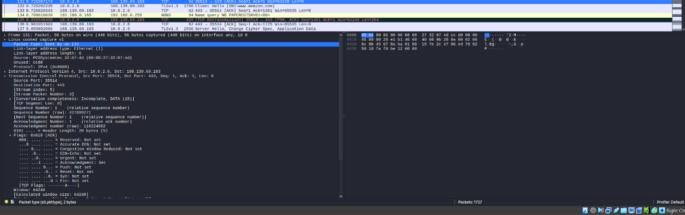
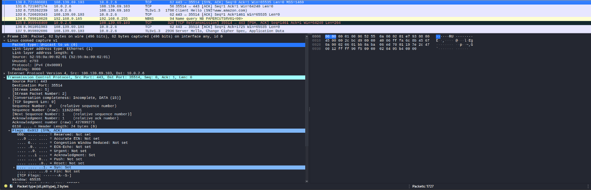
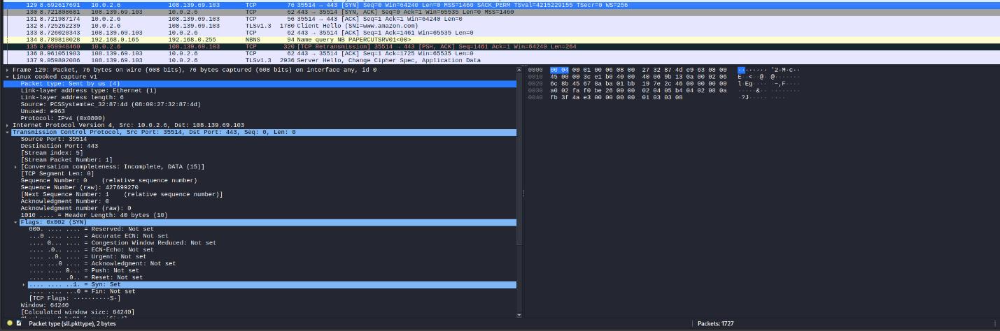
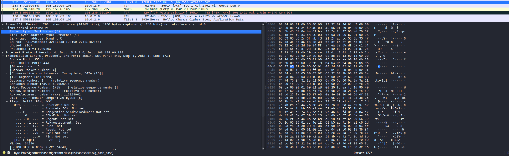
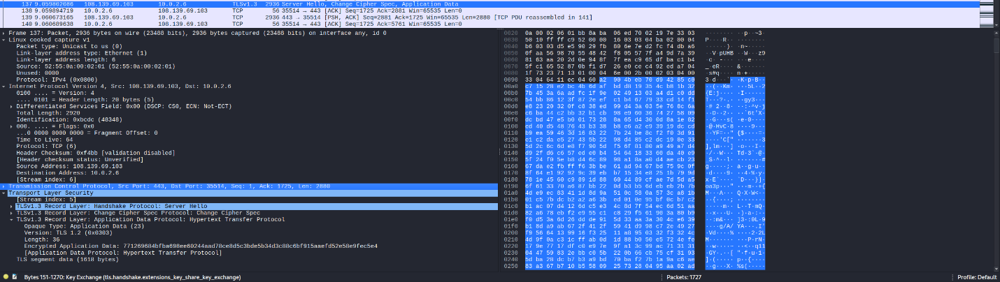
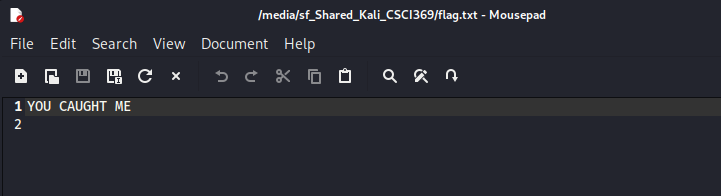
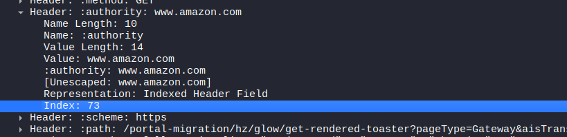
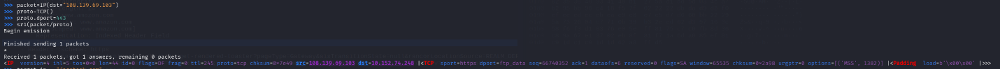

# Network Packet Capture & TLS Decryption (Wireshark)

**Domain:** Ethical Hacking  
**Artifacts:** [`tls_capture_1.pcapng`](./tls_capture_1.pcapng), [`sslkeys.log`](./sslkeys.log)

## Overview & Methodology
Demonstrates TCP connection analysis, TLS cipher negotiation inspection, and pre-master secret TLS decryption in **Wireshark**:
1. **TCP 3-Way & TLS Handshake Inspection:** Analyzed initial `SYN` / `SYN-ACK` / `ACK` connection establishment followed by TLS `Client Hello` and `Server Hello` frames (`supported_versions` extension).
2. **Display Filtering:** Applied protocol and port display filters (`tls`, `tcp.srcport == 443`, `udp.srcport == 443`, `frame.len > 1024`) to isolate encrypted application frames.
3. **Pre-Master Secret TLS Decryption:** Loaded `sslkeys.log` into Wireshark (`Edit -> Preferences -> Protocols -> TLS -> (Pre)-Master-Secret log filename`) to decrypt ephemeral Diffie-Hellman TLS streams and inspect the underlying HTTP application payloads.

## Technical Evidence & Screenshots

