# Network Scanning & Service Enumeration (Nmap & UFW)

**Domain:** Ethical Hacking

## Overview & Methodology
Evaluates host discovery, port scanning, service fingerprinting, and firewall rule probing using **Nmap** against an isolated target VM before and after enabling **UFW (Uncomplicated Firewall)**:
1. **Host Discovery & OS/Service Fingerprinting:** Executed ICMP ping sweeps (`nmap -sn`), TCP SYN stealth scans (`nmap -sS`), OS fingerprinting (`nmap -O`), and service/version detection (`nmap -sV`, `nmap -A -p 21`).
2. **Firewall Hardening & Stateful Rule Verification:** Enabled `ufw` on the target host, selectively permitted specific ports, and compared `SYN` (`-sS`), `ACK` (`-sA`), and `Xmas` (`-sX`) scan responses with polite timing templates (`-T2`) to distinguish filtered vs. unfiltered states.

## Technical Evidence & Screenshots

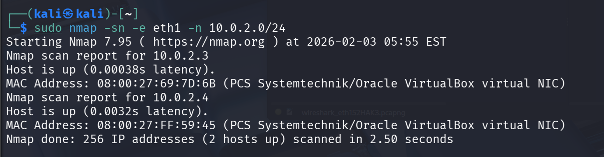

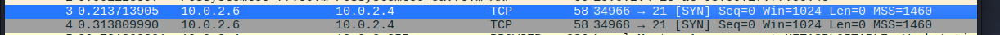

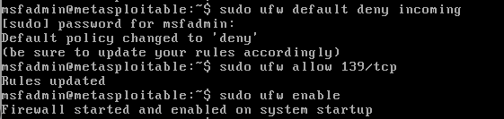

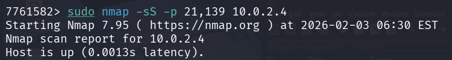

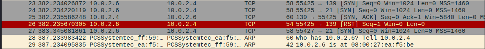

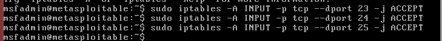

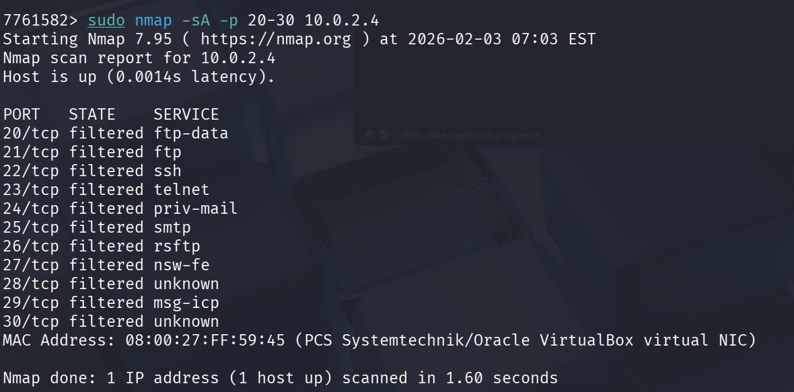

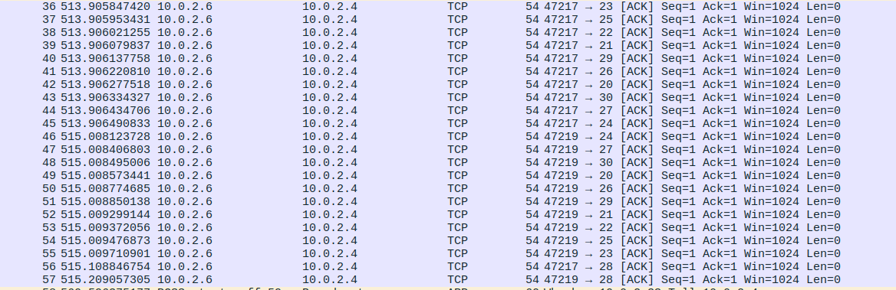

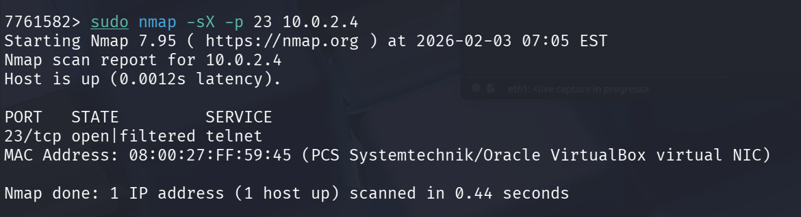

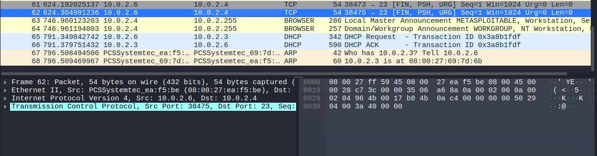

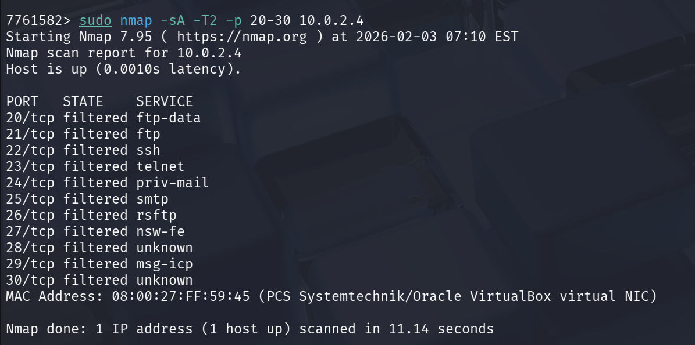

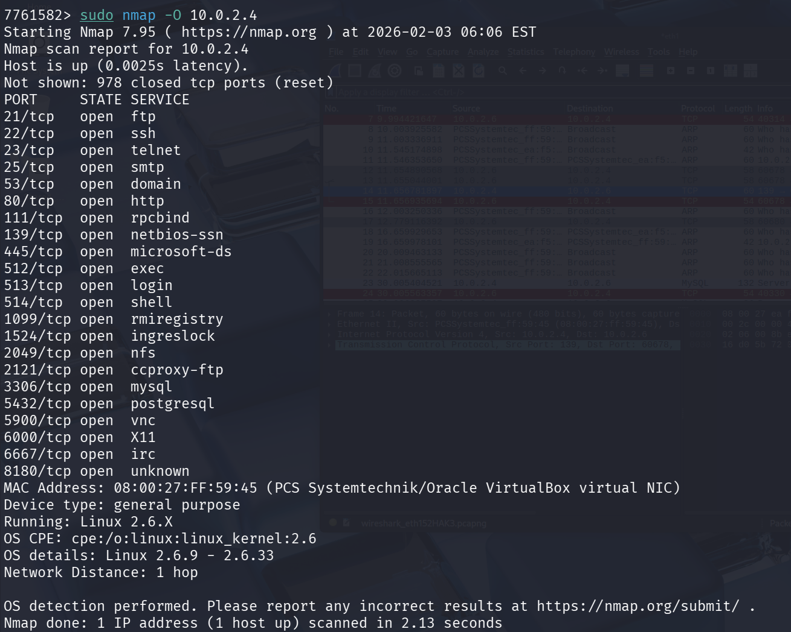

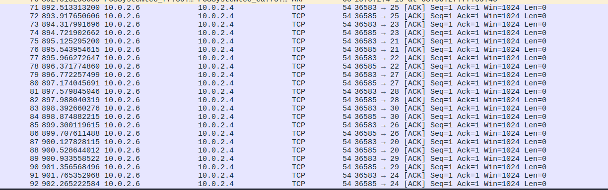

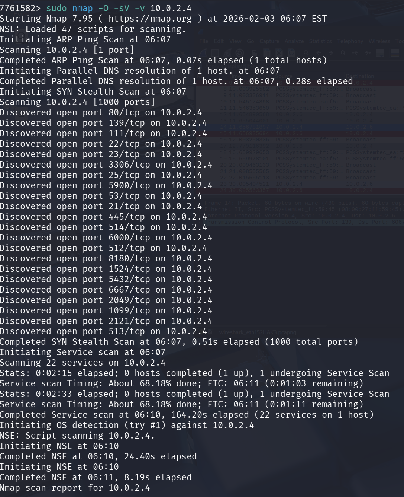

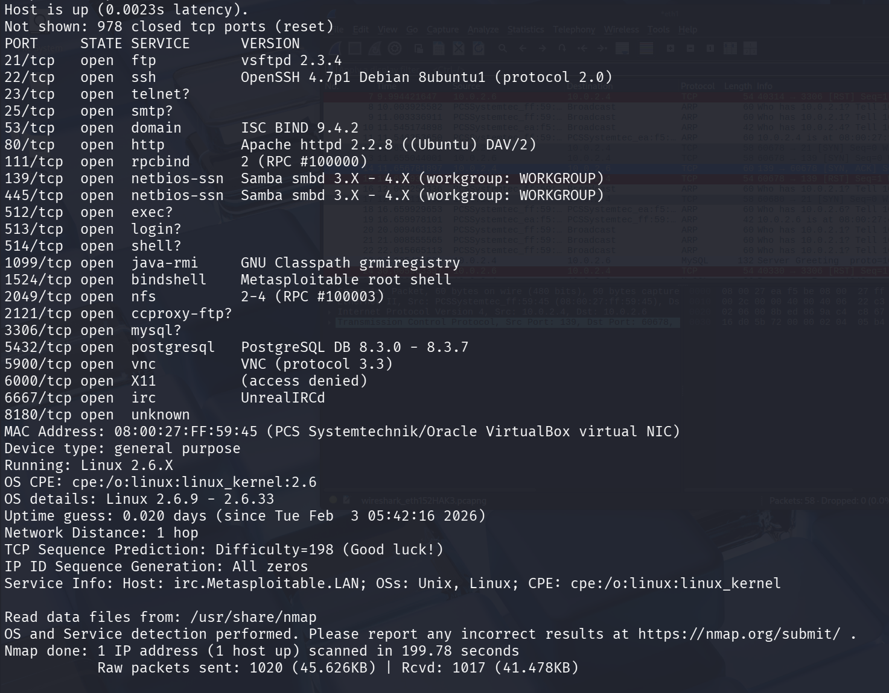

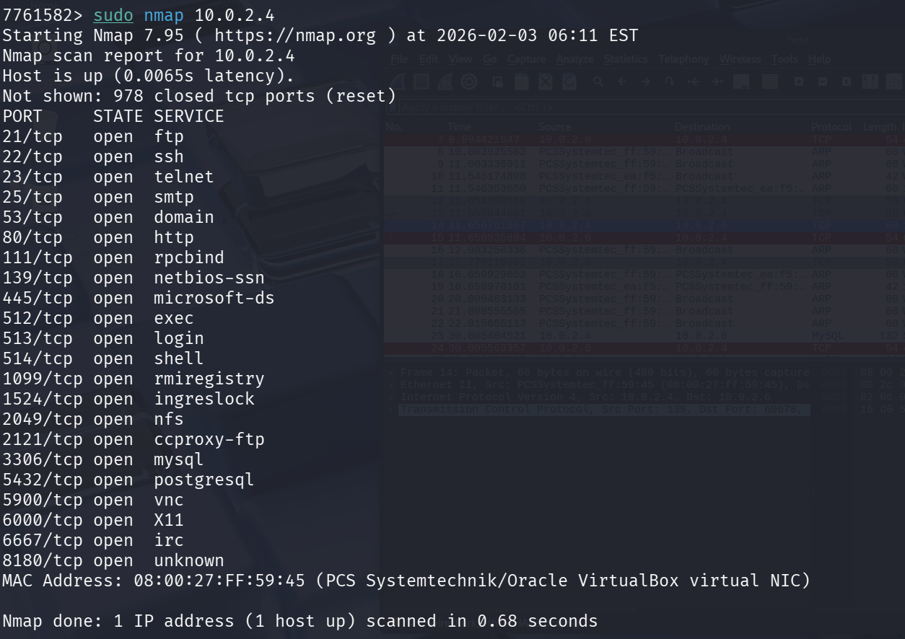

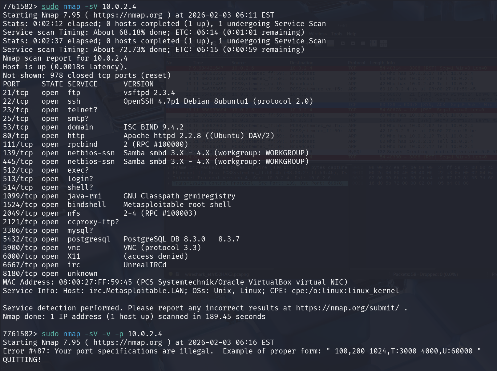

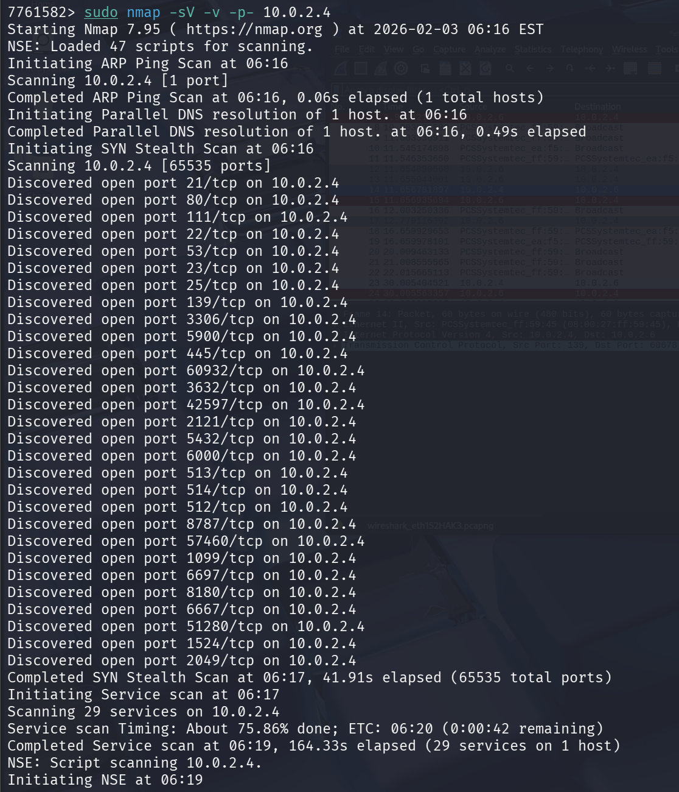

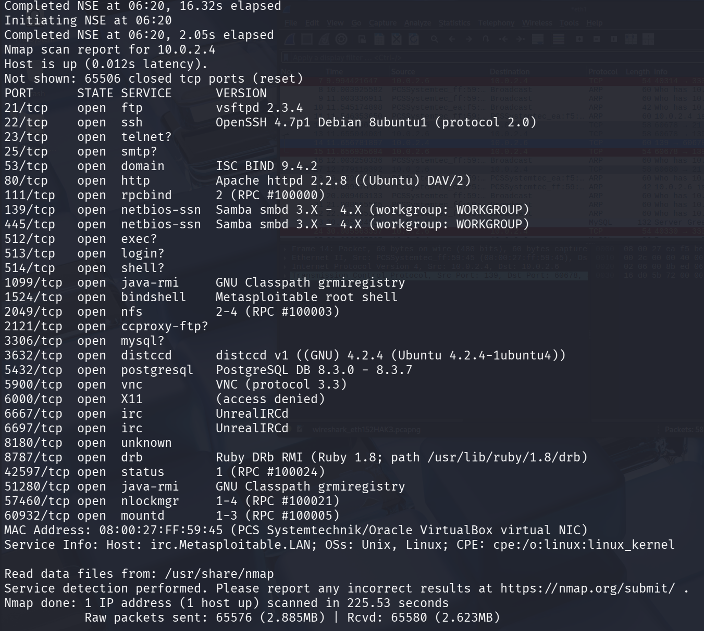

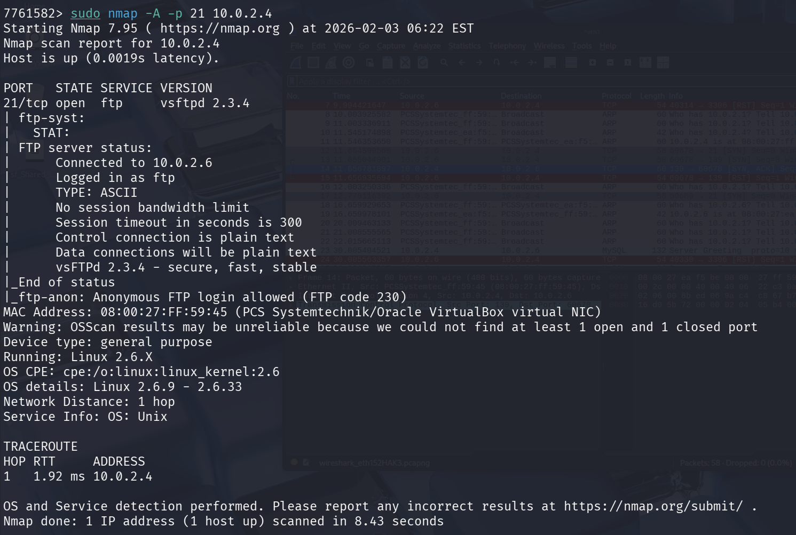
