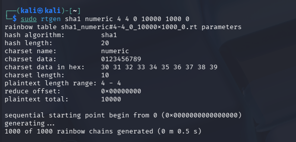
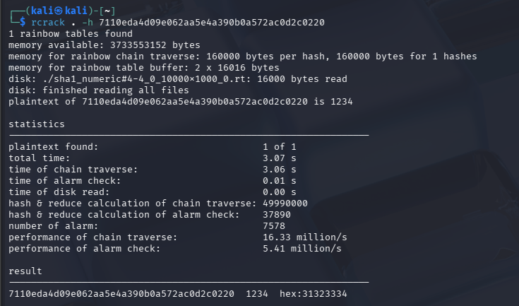
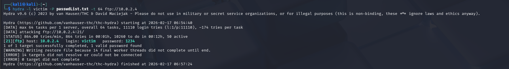
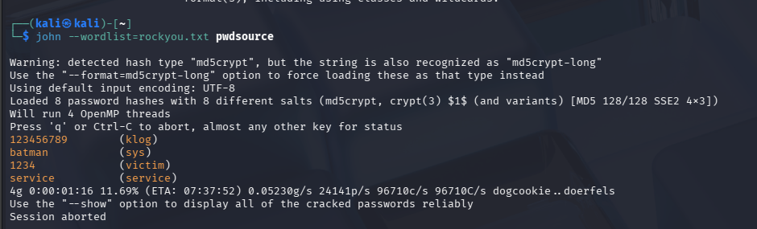
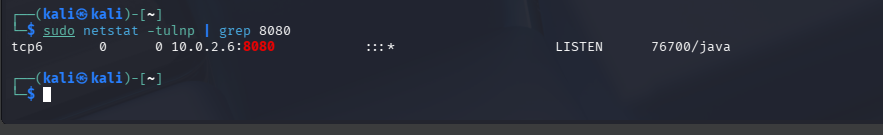
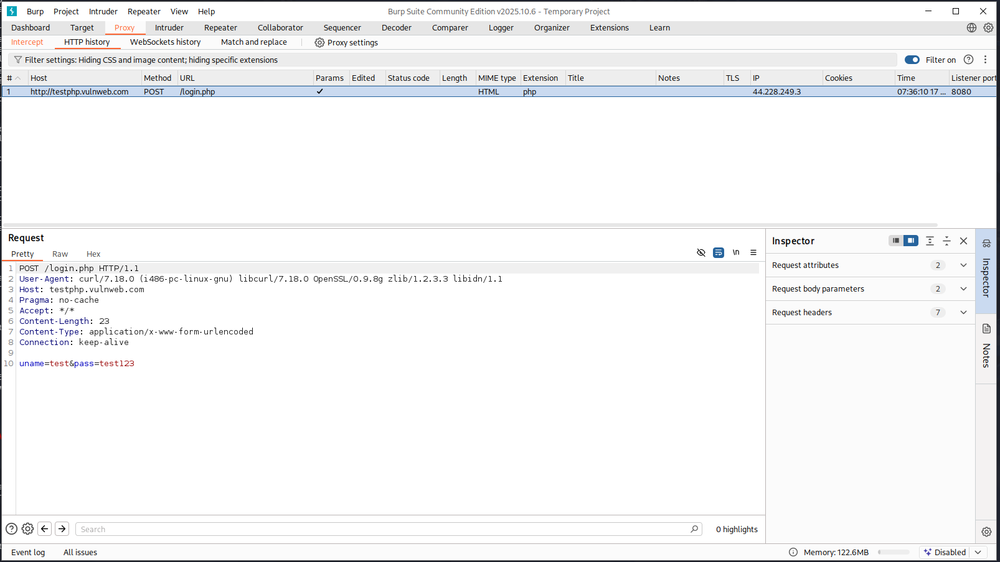

# Password Auditing (Rainbow Tables, John the Ripper, Hydra & Burp Suite)

**Domain:** Ethical Hacking

## Overview & Methodology
Compares offline hash cracking and online authentication auditing techniques in an isolated lab environment:
1. **Time-Memory Trade-Off (Rainbow Tables):** Generated precomputed hash chains (`rtgen`), sorted tables (`rtsort`), and recovered unsalted hashes using `rcrack`.
2. **Offline & Online Dictionary Auditing:** Audited local password hashes using **John the Ripper** and tested network service authentication resilience using **THC-Hydra**.
3. **HTTP Authentication Interception:** Bound **Burp Suite Proxy** to the LAN interface (`:8080`) to inspect and audit web login form submissions.

## Technical Evidence & Screenshots

