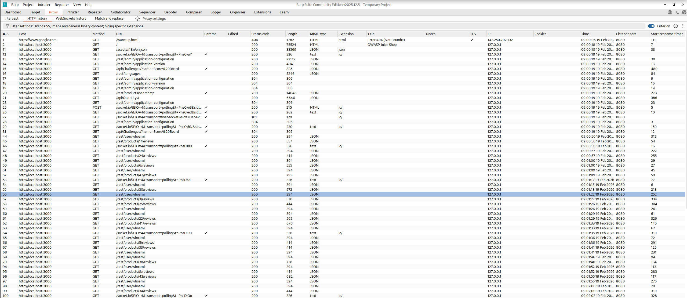
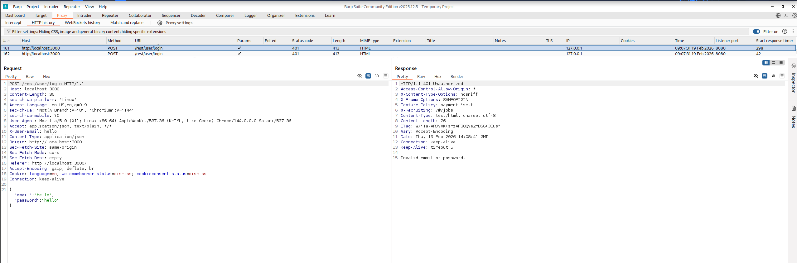
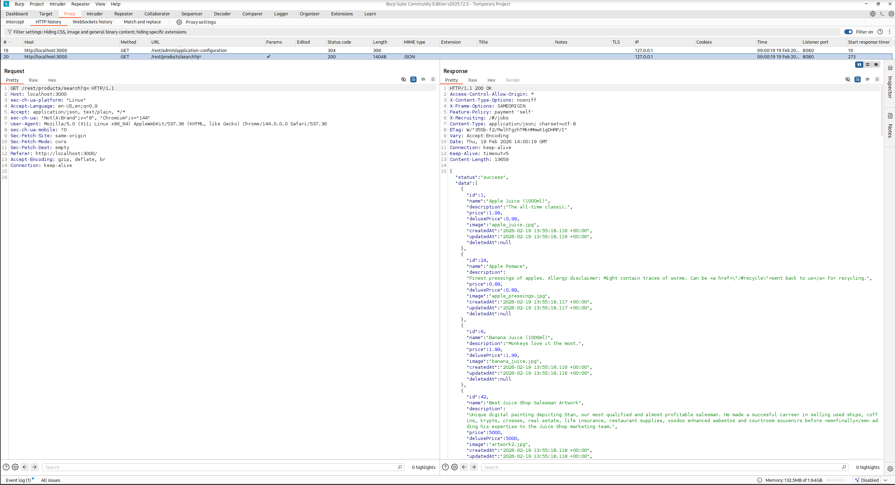

# OWASP Juice Shop Penetration Test — Scanning, Enumeration & Vulnerability Identification
**Domain:** Ethical Hacking

---

## 1. Spidering and Crawling Methodology
To map the attack surface of the target **OWASP Juice Shop** application (`http://localhost:3000` on an isolated Host-Only virtual network `192.168.56.101`), we configured **Burp Suite Community Edition** as an HTTP interception proxy (`127.0.0.1:8080`). Manual passive spidering captured all synchronous and asynchronous REST API calls without triggering automated WAF/rate-limiting rules.

---

## 2. Directory & Parameter Enumeration
Filtering Burp Suite HTTP history to exclude static assets (`.jpg`, `.svg`, `.css`) exposed a Node.js/Express REST API backend under `/rest/` and `/api/`.

### Table 1: Enumerated Endpoint Inventory

| ID | URL / API Endpoint | HTTP Method | Discovered Parameters | Purpose / Functionality |
| :--- | :--- | :--- | :--- | :--- |
| **E-01** | `/rest/user/login` | `POST` | `email`, `password` | Handles user authentication and JWT session issuance. |
| **E-02** | `/rest/products/search` | `GET` | `q` (query) | Executes product catalog search queries. |
| **E-03** | `/api/Challenges/` | `GET` | `name` | Loads challenge state metadata from the backend. |
| **E-04** | `/api/Feedbacks/` | `GET` / `POST` | `captchaId`, `comment`, `rating` | Submits and retrieves customer feedback entries. |
| **E-05** | `/rest/admin/application-configuration` | `GET` | None | Retrieves full application configuration metadata (sensitive info exposure). |

---

## 3. Vulnerability Identification & OWASP Top 10 Mapping

### Table 2: Suspected Vulnerability Matrix

| ID | Target Endpoint | Parameter at Fault | Suspected Vulnerability | Justification & OWASP Top 10 (2021) Mapping |
| :--- | :--- | :--- | :--- | :--- |
| **V-01** | `/rest/user/login` | `email` / `password` | **SQL Injection (SQLi)** | Unsanitized login inputs concatenated into SQLite queries allow authentication bypass (`' OR 1=1--`). Maps to **OWASP A03:2021 – Injection**. |
| **V-02** | `/rest/products/search` | `q` | **Reflected Cross-Site Scripting (XSS)** | Search query `q` is reflected unsanitized into the DOM response. Maps to **OWASP A03:2021 – Injection**. |
| **V-03** | `/api/Challenges/` | `name` | **Broken Access Control / IDOR** | Direct unauthenticated access to administrative/internal API routes. Maps to **OWASP A01:2021 – Broken Access Control**. |

---

## 4. Technical Evidence (Burp Suite Proxy Captures)

### Figure 1: Burp Suite HTTP History & Enumerated REST Endpoints

### Figure 2: Intercepted Authentication Request (`POST /rest/user/login`)

### Figure 3: Intercepted Search Query Endpoint (`GET /rest/products/search?q=`)

